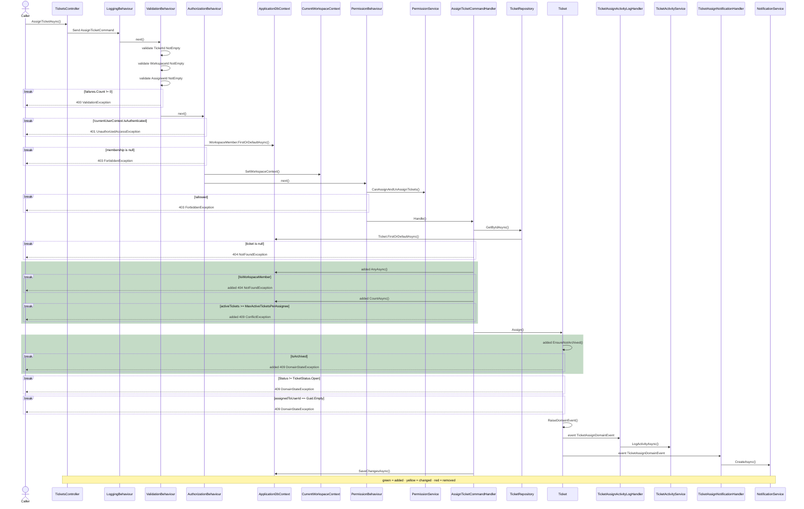

# Pretty Good UML diff

**See what a pull request does to your API, not just which lines changed.**

Pretty Good UML reads your C# solution with the compiler, follows every HTTP endpoint through
your code, and compares the pull request with its base branch. It then posts one comment:

- which endpoints behave differently,
- what was added, removed or changed in each (calls, failure paths with their HTTP status),
- a sequence diagram per endpoint, with the changes highlighted.

A guard clause added two classes away from the controller shows up on every endpoint it affects.
No AI and no tokens: the same code always gives the same report.

It understands controllers, minimal APIs and FastEndpoints, MediatR / Mediator pipelines,
FluentValidation rules, Entity Framework queries, domain events, and the status codes your
exception middleware maps exceptions to. **.NET only.**

## Example

One section of the comment, from a real pull request. The handler gained two checks, and a guard
was added to the `Ticket` entity it calls:

> ### `PATCH /api/v{version:apiVersion}/workspaces/{workspaceId}/tickets/{ticketId}/assign`
>
> - 🟢 New call AssignTicketCommandHandler → ApplicationDbContext: `AnyAsync`
> - 🟢 New failure `404 NotFoundException` when `!isWorkspaceMember` in AssignTicketCommandHandler
> - 🟢 New call AssignTicketCommandHandler → ApplicationDbContext: `CountAsync`
> - 🟢 New failure `409 ConflictException` when `activeTickets >= MaxActiveTicketsPerAssignee` in AssignTicketCommandHandler
> - 🟢 New call Ticket → Ticket: `EnsureNotArchived`
> - 🟢 New failure `409 DomainStateException` when `IsArchived` in Ticket



The green bands are what the pull request added. The same pull request touched four other endpoints,
two of them only through the shared `Ticket` entity; each gets its own section.

## GitHub Actions

Add `.github/workflows/uml.yml`:

```yaml
name: UML diff

on:
  pull_request:
    types: [opened, synchronize, reopened]

permissions:
  contents: read
  pull-requests: write

jobs:
  uml-diff:
    runs-on: ubuntu-latest
    steps:
      - uses: actions/checkout@v5
        with:
          fetch-depth: 0          # the full history, to compare with the base branch
      - uses: actions/setup-dotnet@v5
        with:
          dotnet-version: 10.0.x  # the SDK your solution needs
      - run: dotnet restore MySolution.sln
      - uses: gaumengangster/pretty-good-uml@v1
        with:
          solution: MySolution.sln
          license: ${{ secrets.UML_LICENSE }}   # private repositories only
```

Replace `MySolution.sln` (in both places) with the path to your own solution file.
Later pushes to the pull request update the same comment.

| Input | Default | |
| --- | --- | --- |
| `solution` | (required) | Path to the `.sln`, `.slnx` or `.csproj` |
| `license` | | Licence key, for private repositories |
| `base` | the pull request's base branch | Branch or commit to compare with |
| `version` | latest | Version of the `PrettyGood.Uml` tool |
| `max-diagrams` | `10` | The most diagrams in one comment |
| `comment` | `true` | `false` writes the report to the run summary only |

Prefer plain steps to an action? Copy [`github-actions-uml.yml`](github-actions-uml.yml).

## Azure Pipelines (code on GitHub)

Copy the steps from [`azure-pipelines-uml.yml`](azure-pipelines-uml.yml) into the pipeline that runs
on pull requests, after the steps that install .NET and sign in to your NuGet feeds. Add two secret
variables: `GITHUB_COMMENT_TOKEN` (a GitHub token that may comment on pull requests) and, for a
private repository, `UML_LICENSE`.

## Anywhere else

The tool is a .NET tool on nuget.org:

```
dotnet tool install --global PrettyGood.Uml
pretty-good-uml diff --project MySolution.sln --base origin/main --out report.md
```

`report.md` is GitHub-flavoured Markdown with Mermaid diagrams.

## Price and licence

- **Public repositories: free.** No key, no sign-up.
- **On your own machine: free.**
- **Private repositories in a pipeline: a licence**, per repository or per organization.
  Without one you still get the list of affected endpoints and the full detail of the first one.

A licence is a key you store as the secret `UML_LICENSE`.

## It never blocks a pull request

The diagram is a review aid, not a gate. If the tool fails, or the licence is missing or expired,
the step still succeeds and the pull request stays mergeable.

## What leaves your pipeline

Your code is analysed on your own runner and is never uploaded.

When a pipeline presents a licence key, the tool makes one request to `licence.nikolad.uk` with the
licence id, the repository owner's name and the tool version, to check that the licence has not been
withdrawn. If that request fails, the tool carries on. Public repositories and local runs make no request.

## Limits

- It is static analysis: it shows what the code can do, not what happened in one run.
- Authentication and authorization attributes, middleware and Entity Framework interceptors are not drawn.
- A change inside a pipeline behaviour or middleware does not mark the endpoints behind it as changed.
- Deleted endpoints are not reported.
- Patterns it has not seen may give a shorter diagram. It is tested mostly on solutions that use
  MediatR or Mediator with Entity Framework Core.

## Also available

[Pretty Good UML for VS Code](https://marketplace.visualstudio.com/items?itemName=prettygood.pretty-good-uml):
the same diagrams inside the editor, for any endpoint, class or uncommitted change.
